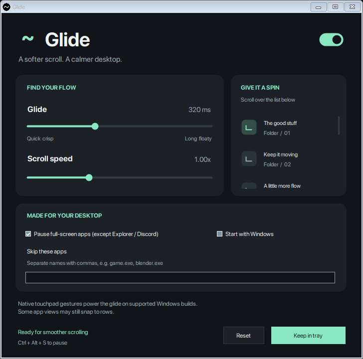

# Glide

### A softer scroll. A calmer desktop.

Smooth, touchpad-like scrolling on Windows 11 using your regular mouse wheel.

[Download v1.0.0](https://github.com/qemvix/Glide/releases/tag/v1.0.0) · [Build from source](#build-from-source) · [Report an issue](https://github.com/qemvix/Glide/issues)

## What it does

Glide turns the separate clicks of a notched mouse wheel into a smooth glide. On supported Windows builds it sends native two-finger touchpad gestures, allowing apps to use their touchpad scrolling behaviour.

**The native touchpad build has been tested and confirmed working in Discord and File Explorer.** Other apps and views may behave differently.

- Adjustable glide duration and scroll speed.
- Vertical and horizontal scrolling.
- A tray menu and **Ctrl + Alt + S** to pause or resume.
- Per-app exclusions.
- Automatic pausing in full-screen apps and games. Discord and File Explorer are exempt from this rule.
- Optional startup with Windows.
- Local preferences and input diagnostics.
- No driver, service, account, network connection, or analytics.

## Download and run

1. Download **Glide-1.0.0-windows-portable.zip** from [Releases](https://github.com/qemvix/Glide/releases/tag/v1.0.0).
2. Extract the ZIP to a folder you want to keep.
3. Run **Glide.exe** and scroll in another app.

You can also download the standalone **Glide.exe**. No installation is needed.

Closing the settings window keeps Glide running beside the Windows clock. Right-click its tray icon to reopen settings, pause, view diagnostics, or quit. The icon may be inside the tray's overflow menu.

The release is an unsigned portable build. Checksums are included as **SHA256SUMS.txt**.

## Requirements

| Requirement | Details |
| --- | --- |
| Operating system | A recent **Windows 11 x64** build exposing the native touchpad injection APIs |
| Runtime | **.NET Framework 4.8** or later |
| Input | A regular notched mouse wheel |
| Privileges | Normal user access; higher-privilege apps retain normal scrolling |

Glide checks API availability at runtime. In **Input diagnostics**, the working native backend is named **Native two-finger touchpad gestures**.

Older or unsupported systems use a wheel-event fallback. That fallback does **not** guarantee the same visual result. There is no claim that every app, view, game, or Windows build behaves identically.

## Controls

| Control | Behaviour |
| --- | --- |
| Main switch | Enable or pause smoothing |
| Glide | Duration of the eased movement: 100–700 ms; default 320 ms |
| Scroll speed | Movement multiplier: 0.25×–2.50×; default 1.00× |
| Full-screen pause | Preserve normal wheel behaviour in full-screen apps and games |
| Skip these apps | Comma-separated executable names, such as game.exe, blender.exe |
| Start with Windows | Optional; starts Glide quietly in the tray |
| Ctrl + Alt + S | Toggle smoothing, if the shortcut is available |

Modifier-wheel shortcuts, including Ctrl+wheel zoom, pass through. Existing precision wheel input is not smoothed again. Clicking, changing scrolling controls, changing settings, or switching windows ends the remaining glide.

The full-screen rule follows Windows' wheel-routing setting. It is based on window coverage rather than a list of detected games. Use exclusions for windowed games. Discord, Discord Canary/PTB, and File Explorer remain eligible even if their windows cover the screen.

If startup is enabled, keep Glide.exe at its configured location. Turn startup off before moving or removing it.

## Build from source

The build uses the Microsoft C# compiler included with .NET Framework. There are no NuGet packages or external libraries to restore, and the .NET SDK is not required for the scripted build.

From the repository root, in Windows PowerShell:

~~~powershell
powershell -NoProfile -ExecutionPolicy Bypass -File .\scripts\build.ps1
~~~

The result is **bin/Glide.exe**.

Run the non-interactive regression checks:

~~~powershell
powershell -NoProfile -ExecutionPolicy Bypass -File .\scripts\test.ps1
~~~

Run the native touchpad checks on a supported PC:

~~~powershell
powershell -NoProfile -ExecutionPolicy Bypass -File .\scripts\test.ps1 -NativeInput
~~~

**Quit Glide before the native checks.** Those checks briefly open a receiver window, move the pointer into it, and restore the previous pointer position and window. Leave the mouse still while they run. They are intended for an interactive desktop, not a CI runner.

Create a portable package from your build:

~~~powershell
powershell -NoProfile -ExecutionPolicy Bypass -File .\scripts\pack.ps1
~~~

Packages and checksums are written to **dist/**. See [Testing](docs/TESTING.md) for details.

## Source layout

| Path | Purpose |
| --- | --- |
| src/Glide/App.cs | Settings window, preview, tray integration, hotkey, and entry point |
| src/Glide/ScrollEngine.cs | Dedicated mouse hook, eligibility checks, motion scheduling, and cancellation |
| src/Glide/Touchpad.cs | Native gesture-only touchpad device, frame submission, and cleanup |
| src/Glide/Settings.cs | Preferences, persistence, and eased motion pulses |
| src/Glide/Native.cs | Windows API declarations and native data layouts |
| src/Glide/Diagnostics.cs | Local diagnostic window and same-user named pipe |
| src/Glide/Tests.cs | Core regression checks and the legacy wheel fallback harness |
| tests/TouchpadTest.cs | Native touchpad receiver and end-to-end input checks |
| scripts/ | Build, test, and portable packaging commands |
| docs/ | Architecture, validation, and usage documentation |

Read [Architecture](docs/ARCHITECTURE.md) before changing the input pipeline. The low-level hook must remain quick, generated input must not be recaptured, and virtual contacts must be released when motion ends.

## Preferences and privacy

Preferences are stored in:

~~~text
%LOCALAPPDATA%\GlideScroll\settings.xml
~~~

When you enable startup, Glide writes its own entry in the current user's Windows Run key.

Input diagnostics remain on the PC. They include process names, wheel counts, output mode, and cancellation reasons. They do not contain chat content, window titles, passwords, or a keyboard log.

## Troubleshooting

Open **Input diagnostics** from the tray menu after scrolling in the affected app:

- **Output mode** identifies native touchpad gestures or the fallback.
- **Last decision** explains whether the wheel was smoothed or passed through.
- **Last cancellation** explains why a glide stopped.
- **Last error** reports blocked output or an unavailable service.

Apps running at a higher privilege level are left alone. If generated input fails, Glide pauses its output and restores normal wheel input.

The release tag is **v1.0.0**, the first public release. The preserved executable's diagnostic header uses the internal native engine label **Glide 2.0**.

## Validation

The native receiver confirmed real Windows touchpad input, moving physical contact coordinates, clean release, and zero generated mouse clicks. The complete pipeline converted one wheel notch into touchpad movement without recursive capture. Discord and File Explorer were then visually verified on the test PC.

See [Validation](docs/VALIDATION.md) for the checks and the preserved executable's SHA-256.

## License

No software license has been selected for this repository. No LICENSE file is included.
